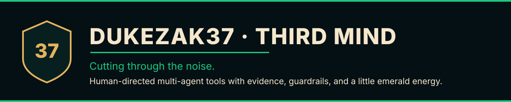

  

### Hi, I'm Duke

U.S. Army veteran (Fire Finder radar operator) and hands-on builder, with a background in electronics troubleshooting,
heavy equipment, mechanic work and safety leadership. I present to groups, make online videos, and have used voice,
streaming and remote-collaboration tools for years. I work in automotive sales by day, and I've spent a lot of
(self-reported) hours experimenting with Grok on games, workflows and bots.

I direct **Third Mind**, a human-led experiment in running a small team of AI agents. I set the missions and approve
anything public, paid or security-sensitive. Devin, Cognition's AI engineer, running as my bot "Bahamut", builds and
tests the code. I document what works, what is still simulated, and what broke.

*Third Mind is under active development; new work lands almost daily.*

**Showcase:** [third-mind-showcase](https://github.com/DukeZak37/third-mind-showcase): case study, architecture and real-vs-simulated status. **Website:** https://dukezak37.github.io/third-mind-showcase/

| What | Status |
|---|---|
| Skynet, a disclosed Discord bot with dashboards, role menu and slash commands | REPORTED LIVE |
| Telegram community bot with a join welcome | REPORTED LIVE |
| Agent hub with shared memory, approvals, budgets and audit log | DEV-TESTED |
| GPT and Grok replies in Discord | SIMULATED |
| Dedicated Grok Slack bot (the team uses a human-relayed workflow today) | PLANNED |
| Paper-trading research (no real orders) | PLANNED |

See the [showcase status](https://github.com/DukeZak37/third-mind-showcase/blob/main/docs/STATUS.md) for evidence and limits.

**How I work:** bots are always labeled, nothing risky happens without my approval, simulated output says so, and no
secrets go in Git.

Third Mind is an independent project and is not affiliated with or endorsed by Cognition.
